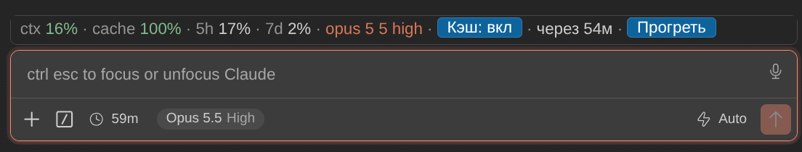

# Cache Keeper

Плагин Claude Code для графического чата VS Code: не даёт prompt cache чата остыть, пока вы отошли, и показывает над полем ввода контекст, кэш и лимиты подписки.



## Установка

```sh
claude plugin marketplace add TertiumOrganum1/claude-cache-keeper
claude plugin install cache-keeper@tertium-cache-keeper --scope user
```

Затем `Developer: Reload Window` в VS Code.

Обновление:

```sh
claude plugin marketplace update tertium-cache-keeper
claude plugin update cache-keeper@tertium-cache-keeper --scope user
```

## Как работает

- За 5 минут до истечения кэша (TTL 1h) плагин отправляет короткий запрос поверх контекста чата. Контекст читается из кэша, и срок жизни кэша продлевается ещё на час.
- Прогрев включён по умолчанию, но начинается только после ответа Claude в этом чате. После перезапуска VS Code старые чаты сами ничего не отправляют.
- Каждый прогрев - запрос к модели и расходует лимиты подписки или API. Ненужные чаты выключайте кнопкой `Кэш: вкл/выкл`.
- Промах или ошибка показываются в строке; кнопка `Прогреть` повторяет попытку сразу.

## Команды

- `/cache-on`, `/cache-off` - прогрев в текущем чате.
- `/cache-status` - подробное состояние.
- `/cache-keeper now` - прогреть сейчас.
- `/cache-keeper on 5m`, `/cache-keeper on 1h` - TTL.
- `/cache-keeper clock on`, `/cache-keeper clock off` - штатный таймер, см. ниже.

## Штатный таймер Claude Code

Индикатор времени кэша в самом Claude Code прогревов не видит. Чтобы он их учитывал, выполните в чате `/cache-keeper clock on` и перезагрузите окно.

Команда правит файлы расширения Claude Code (`webview/index.js`, `webview/index.css`). Оригиналы сохраняются в `~/.claude/cache-keeper/backups`. После обновления расширения правка накладывается заново при следующем запуске; на несовместимой версии плагин ничего не меняет и пишет об этом в строке. `/cache-keeper clock off` возвращает оригинальные файлы.

## Подробнее

- [Как работает прогрев](docs/how-it-works.md): когда отправляется, сколько стоит, как проверяется результат, все команды.
- [Штатный таймер Claude Code](docs/native-clock.md): что именно правится в расширении, обновления, откат.
- [Проверки](docs/testing.md): тесты и что они покрывают.
